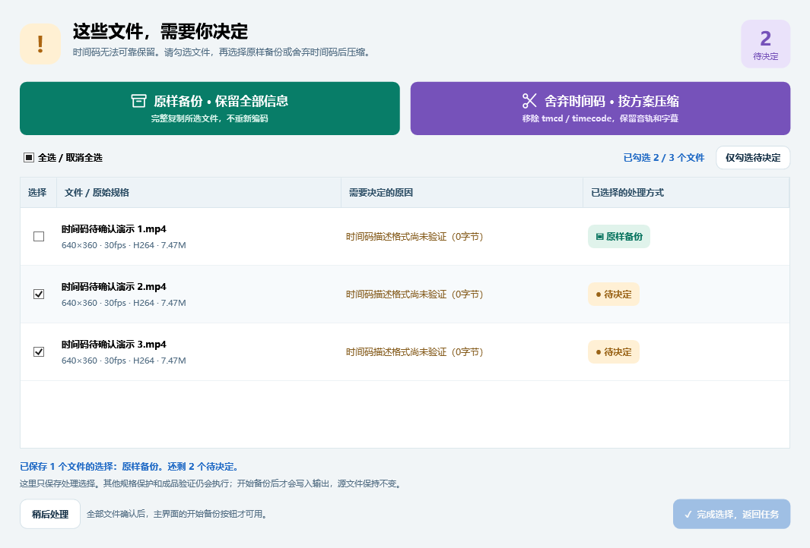

# VideoArchive · 视频压缩备份

Windows 11 原生桌面程序，使用 FFmpeg 压缩视频素材库，保留分类目录、文件名、空目录及配套文件。默认只降不升，已经满足目标的视频直接原样复制。

[](https://github.com/cz15909681360-create/VideoArchive/actions/workflows/build.yml)

**当前版本：1.3.0 · Windows x64 · C# / WPF / .NET 10**

[下载便携版](https://github.com/cz15909681360-create/VideoArchive/releases/latest) · [使用与常见问题](docs/USER-GUIDE.md) · [架构与决策规则](docs/ARCHITECTURE.md) · [构建与发布](docs/BUILDING.md) · [更新记录](CHANGELOG.md)

- 自动检测 CPU / NVIDIA / Intel / AMD 编码能力，环境未变时复用本地缓存。
- 智能推荐或固定码率上限，不放大画面、不增加帧率；支持 HEVC、H.264、AV1。
- 原目录旁输出完整的 `_已压缩` 文件夹，镜像目录结构、配套文件及空目录。
- 10-bit 4:2:2 / 4:4:4 等高色度素材按要求转换为 HEVC Main10 / 10-bit 4:2:0。
- 时间码无法可靠保留时弹出文件决策窗口，支持单选、全选和批量处理。
- 暂停、继续、取消、重试、中断恢复、CSV / JSON 报告，以及自定义壁纸。



## 运行

解压 `VideoArchive-v1.3-win-x64.zip`，进入 `VideoArchive-v1.3-win-x64` 文件夹，双击 `VideoArchive.exe`。保留同目录的 `tools` 和 `licenses` 文件夹；无需另装 .NET、Python 或 FFmpeg。

启动后先弹出源文件夹选择，同时在后台检查编码能力。首次启动会实际测试 CPU、NVIDIA、Intel、AMD 编码器及位深能力，并缓存结果。下次启动，设备、显卡驱动、Windows 环境及 FFmpeg 二进制未变化时直接复用缓存，不再运行短帧试编码。缓存损坏、检测不完整或超时会重新检测；“设置 → 保存路径并重新检测”可强制重检。主程序离线运行，不上传视频。

1. 选择源素材目录。默认在源文件夹旁创建完整的“源文件夹名_已压缩”，例如 `D:\素材` → `D:\素材_已压缩`。勾选“输出到其他文件夹”并选择存放位置后，会在该位置下创建同名的完整备份文件夹。源目录和最终输出目录不能相同或互相包含。
2. 选择备份方案。默认 HEVC、VBR、平衡 ×1.0、源分辨率、源帧率、源位深、原音频。
3. 点击“扫描”，检查每个文件的目标、操作与原因。最多并行探测4个文件；普通8-bit SDR不解码视频帧，HDR/10-bit继续检查必要帧元数据。探测缓存会跨程序重启保存，依据路径、大小、修改时间和引擎版本复用。参数变更重新计算计划；首次启用帧率限制需要重新扫描，以获取完整包时间信息。
4. 如果时间码无法可靠保留，扫描结束会自动弹出文件决策窗口。列表提供逐个勾选、全选和“仅勾选待决定”；选好文件后，点击顶部绿色档案图标的“原样备份 · 保留全部信息”，或紫色剪刀图标的“舍弃时间码 · 按方案压缩”。列表使用琥珀色标记待决定、绿色标记原样备份、紫色标记舍弃时间码。选择立即保存到任务，修改参数时保留，也可重新打开窗口修改决定。“稍后决定”允许先返回查看方案；仍有待决定文件时，开始按钮不可用。
5. 点击“开始 / 恢复备份”。每个成品在临时路径完成验证后，才放入正式输出位置。
6. 查看实际报告，可导出 CSV / JSON。历史页面可载入中断任务；已经完成的文件核对 SHA-256 后跳过，未完成文件重新处理。

## 外观与壁纸

深色侧栏搭配浅色卡片；蓝色表示扫描，绿色表示备份，紫色表示编码，琥珀色表示需要决定的事项。源目录、备份位置与最终参数使用图标、颜色和字号区分。

点击顶部“自定义壁纸”，或进入“设置 → 外观与壁纸”，选择本地 PNG、JPG、JPEG、BMP、GIF 图片，并调整显示强度。GIF 使用静态画面。壁纸会复制到 `%LOCALAPPDATA%\VideoArchive\appearance` 并保存设置；原图片移动或删除后仍可加载。可随时恢复默认背景，壁纸不会写入备份素材。

## 参数

- **智能推荐**：按最终输出尺寸、帧率、编码和 HDR 计算。HEVC 1080P30 基准 10 Mbps、1080P60 15 Mbps、4K30 32 Mbps、4K60 48 Mbps。画面不做题材分类，也不做复杂度分析。
- **备份系数**：0.75 空间优先、1.0 平衡、1.25 高质量、1.5 极高质量。建议属于工程估算，不能保证特定视频的主观画质。
- **固定上限**：手动输入平均视频码率。与智能推荐二选一，音频不计入该视频码率。
- **VBR**：默认最大瞬时码率为平均目标的 1.5 倍。CBR 保留供特殊用途；不使用填充数据强制浪费空间。恒定质量模式使用相应编码器 CRF/CQ，输出容量仅粗略估计。
- **SVT-AV1 / CPU**：VBR 支持平均目标但不支持独立峰值上限，界面禁用相应峰值设置；CBR 不提供。恒定质量可使用其支持的最大码率约束。
- **最高1080P**：横屏限制到 1920×1080，竖屏到 1080×1920，保持比例。720P 不会放大。
- **最高帧率**：只对超过限制的素材丢帧，不插帧；保持23.976/29.97/59.94等小数帧率。VFR 按包时间检查峰值节奏，不能只看平均帧率。
- **统一编码格式**：关闭时，码率已足够低的 H.264 可以直接保留，即使目标方案是 HEVC；开启则转换编码不符的视频。
- **Profile 自动适配**：按每个文件的目标编码和位深选择：HEVC Main / Main10，H.264 High / High10，AV1 Main。不因旧预设的 Profile 与源位深冲突而直接跳过，不通过 Profile 将8-bit源强制升为10-bit。实际选择显示在扫描表中。
- **详细参数**：位深、编码器 Preset、恒定质量值、VBR 峰值、10%默认容差、15%默认最低收益、AAC码率、并行数、已存在冲突规则、NVIDIA AQ / Look-ahead。Profile、Level、GOP和B帧自动。
- **已存在文件**：默认跳过，也可选覆盖或自动重命名。覆盖只在新成品验证成功后进行。

低于上限的素材不重编码。仅因码率触发时，同时要求超过容差并达到预计收益；降尺寸、限帧、统一格式、音频转码不受最低收益阻止。所有转码平均目标不高于已知源码率，成品更大或规格保护不通过时改为备份原文件。

## 素材保护与验证

音轨、字幕、章节、缩略图、色彩、可支持的元数据和文件创建/修改时间尽量保留。**压缩视频时，特殊数据轨仅保留时间码 `tmcd`；Sony `rtmd`、DJI `djmd/dbgi` 和其他 data/unknown 轨移除**，扫描原因明确列出此处理。原样复制的文件仍完整保留原内容。

时间码保留原计数、帧率解释与 drop-frame/24小时等标志，MOV复制后恢复描述；常规MP4时间码由封装器创建合法轨道后恢复原4字节计数和描述，随后验证。非常规、多轨或描述不受支持的时间码交由用户选择。选择舍弃时，仅在实际压缩输出中移除 `tmcd` 和全局/各轨的 `timecode` 标签，保留音轨、字幕和其他可支持元数据；选择原样备份时按完整文件复制并校验 SHA-256。

**10-bit 4:2:2 / 4:4:4 及更高位深 YUV 素材自动转换为10-bit 4:2:0、HEVC Main10**，使用所选 CPU / GPU 后端；即使普通方案选择 H.264、AV1 或8-bit，这类文件仍按 Main10 输出。按最终 HEVC 规格推荐码率，目标不高于已知源码率。色度/位深转换为明确要求，不受最低收益门槛阻止；实际成品仍检查不增大。扫描表与原因注明转换，编码器不支持HEVC 10-bit时原样保留并说明。此规则允许减少色度/高于10-bit的位深，分辨率、帧率继续只降不升。

舍弃时间码只解除时间码保护，仍按当前压缩方案处理。静态 HDR10 / HLG 需要保留色彩及必要 HDR 元数据，否则原样复制。Dolby Vision、HDR10+、多画面轨、透明/隔行素材及未验证容器组合仍采取保守原样备份，并显示对应原因。

主转码容器验证覆盖 MP4、MOV、MKV；其他视频容器仍纳入扫描和目录镜像，默认原样备份。复制结果校验大小与 SHA-256；转码结果检查尺寸、编码、位深、时长、帧率、轨道、章节、重要元数据并完整解码。若完整解码发现错误，则标记失败。源文件自扫描后改变会拒绝处理，需重新扫描。

照片、字幕、工程等非视频文件完整复制。目录联接和符号链接不跟随，报告会列出未处理项。预设、任务历史和探测缓存在 `%LOCALAPPDATA%\VideoArchive`。旧任务若需采用新数据轨规则，应重新扫描；已完成的旧备份不会自动改写。暂停队列会让当前文件完成；取消会终止正在编码的进程并清理临时文件。运行中关闭窗口会先取消，待停止后再关闭。

报告“节省容量”只统计实际完成并验证的文件，不将已存在跳过文件、失败文件计为节省。完整校验及哈希会增加磁盘读取时间，网络磁盘和大素材库尤其明显。

## 从源码构建

在仓库根目录运行 PowerShell：

```powershell
./build.ps1 -Test
./build.ps1 -Integration
./build.ps1 -Package
```

脚本会把 .NET 10 SDK 放在仓库 `.tools` 中。打包与集成测试需要 PATH 中可用的 FFmpeg / FFprobe；打包会将这两个程序复制至便携包。源码分为不依赖界面的 `VideoArchive.Core`、原生 WPF / MVVM `VideoArchive` 和自包含测试运行器 `VideoArchive.Tests`。

集成测试在 `artifacts` 下生成小样，验证 CPU、NVIDIA、Intel 编码、配套资料、文件时间、元数据、多音轨、字幕、中断恢复和冲突规则；相关硬件不可用时会报告失败，不伪造成功。

第三方组件、许可证和对应源码入口见 `THIRD-PARTY-NOTICES.md` 及便携包 `licenses` 文件夹。

## 参与开发

问题反馈请使用仓库的 [Issues](https://github.com/cz15909681360-create/VideoArchive/issues)。开发约定见 [CONTRIBUTING.md](CONTRIBUTING.md)，安全问题见 [SECURITY.md](SECURITY.md)。源码采用 [MIT 许可证](LICENSE)；便携包中 FFmpeg / FFprobe 及其他组件适用各自许可证。

本仓库不包含个人素材、任务清单、硬件缓存和本机日志。历史验收记录见 [VERIFICATION.md](VERIFICATION.md)，其中 `artifacts/` 日志是本机验收产物，不随源码提交。GitHub Actions 执行 Windows 构建和核心检查；实际 GPU 编码验收需要具备相应设备的本机环境。
