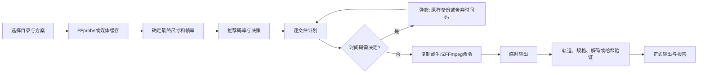

# 架构与决策规则

## 项目结构

```text
src/VideoArchive/       WPF视图、MVVM交互、文件决策弹窗、外观与壁纸
src/VideoArchive.Core/  媒体探测、能力缓存、推荐、计划、执行、验证和持久化
tests/VideoArchive.Tests/ 自包含控制台测试运行器
docs/                  使用、设计、构建发布说明及演示截图
.github/               Windows构建工作流、问题和PR模板
```

核心项目不依赖WPF。主程序使用本地文件和独立FFmpeg/FFprobe进程，无服务端。

## 数据流程



`ProbeService`解析媒体；视频码率缺失时通过视频包统计补算。`Recommendation`按规格表插值，表外标记估算。`DecisionEngine`生成带原因的`PlanItem`。`ScanService`管理目录遍历、四路探测缓存和计划重算。`CommandBuilder`使用参数数组生成命令。`ArchiveService`执行已经确认的计划、验证输出并保存任务；`JsonStore`负责本地JSON原子替换。

## 重要不变量

- 不修改源文件；输入和输出相同或嵌套时拒绝；不递归跟随联接及符号链接。
- 不放大画面、不增加帧率，转码平均码率目标不超过已知视频源码率。
- 智能码率在最终尺寸、帧率确定后计算；1080P限制区分横竖屏并保持比例。
- 码率单独触发转码时同时满足容差和最低收益；其他明确转换要求可绕过收益门槛。
- 保留未超限的原时间戳；限帧通过丢帧实现，VFR检查峰值节奏。
- 特殊数据轨仅保留已验证的`tmcd`；未验证时间码须由用户决定。舍弃时间码不解除HDR、字幕和容器等其他保护。
- 高位深高色度YUV按用户要求转换为10-bit 4:2:0 HEVC Main10，逐文件覆盖普通方案编码和位深。
- 原样复制核对大小和SHA-256；转码核对轨道、时长、编码、位深、色彩及重要元数据，并完整解码。
- 先写临时文件，验证完成后提交正式输出；实际更大时备份原文件并记录原因。
- 仅实际完成且验证通过的输出计入节省容量；容量与画质推荐为估计。

## 计划、恢复与界面

`ArchiveJob`保存源/输出根目录、参数快照、计划版本、文件大小及修改时间；`PlanItem`保存源信息、目标、操作、原因、预计容量、输出路径和执行状态。执行直接读取计划，避免界面与实际行为不一致。源自扫描后改变或计划版本过旧时要求重新扫描。中断恢复核验已完成输出，未完成项从头处理。

文件决策弹窗将勾选与决定分开；全选支持混合状态。决定先写入克隆计划并保存，再替换当前计划，避免保存失败时界面显示未持久化的决定。待决定项目存在时禁止开始。

## 缓存与能力

硬件能力缓存核对FFmpeg内容哈希、本机CPU、显卡/驱动、Windows及会话环境。短帧试编码确认真实可用性，超时或不完整检测不形成有效缓存。硬件编码失败保留日志并标记失败，不静默切换设备。

媒体探测缓存按路径、大小、修改时间及工具身份复用；修改参数主要重算决策。位深、Preset和码率模式选项根据能力限制，Profile按每个目标编码和位深自动适配。

壁纸采用WPF图像按加载读取、缩小解码并冻结；导入后保存本地副本，外观配置与编码方案分离。图片丢失或无法读取时使用默认背景。
